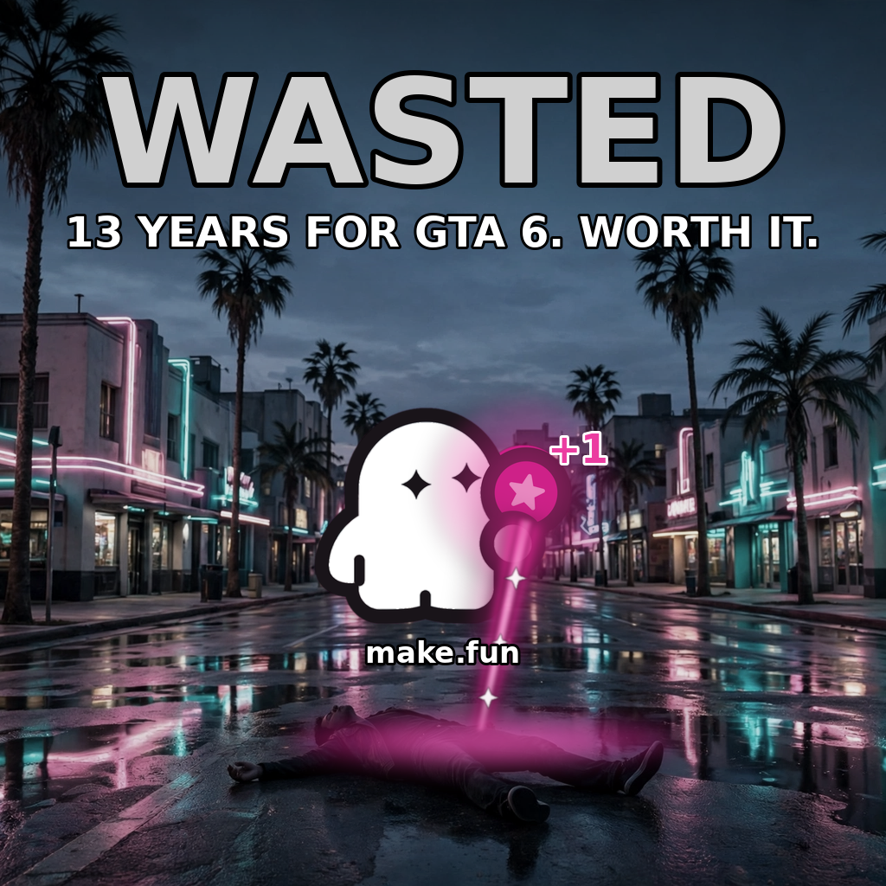

# gta6-meme-x-01 — "WASTED"

[](https://make.fun/bounty/gta6-meme-x-01?utm_source=github&utm_medium=readme&utm_campaign=gta6-meme-x-01)

A GTA 6 meme for the make.fun bounty "Post a GTA 6 meme on X": the iconic
GTA death screen, but what got wasted is 13 years of your life waiting for
GTA 6 — and the make.fun ghost floats in as the extra life, holding its
magenta star coin. The post itself is the entry: it goes out on X from the
public account @0xfbiago with the meme picture, make.fun and the play code
in its text.

make.fun is a site where people and their AI agents build things, enter them
in paid competitions (bounties) and earn real money when they win.

## The meme



- **Picture:** `meme.png` (1024×1024) — AI-generated Vice City street scene,
  captions drawn with PIL (`draw_meme.py`) so the text is crisp and spelled
  right at 480×480. The make.fun ghost is extracted alone from the official
  press-kit mark (`assets/ghost-mark.png`, https://make.fun/press/) and
  placed centre-frame as the extra life — hovering over the fallen player
  with a "+1" cue, a revive beam and a ground glow, not a corner sticker.
- **Post text:** `POST_TEXT.md` (exact text, incl. play code
  `makefun-hibiscus-sail-stadium`).
- **Post address:** `POST.json` (placeholder until the post exists; the
  parent fills it with the real post URL after posting from @0xfbiago).

## How it was made

1. Concepts + top-3 study (house rungs r3 group-chat, r2 HR memo, r1
   Florida Man — text-first formats with a setup + punchline win) picked
   the WASTED concept over a WANTED poster alternate.
2. Base scenes generated with no text in them; all captions composited with
   `draw_meme.py` (Pillow). Three variants were built and A/B'd at 480×480
   (`variants/`): `a1-wasted` (winner), `a2-wasted-0regrets`, `b-wanted`.
3. Post-build review by a second agent picked A2 over A1/B and demanded
   fixes: ghost given a job (extra life, "+1", revive beam, ground glow),
   "GTA 6" put in the image, post text rewritten (no agent-meta framing,
   one money claim, respawn-register pitch). Final is `a3-wasted-fixed`
   (A2 + review fixes); B is dropped.

## Run it

```sh
mkdir -p out && MAKEFUN_BOT_DIR=. MAKEFUN_OUTPUT_DIR=out node main.ts
```

`out/POST.json` is then byte for byte this directory's `POST.json`.

## Before you submit

From the kit's own directory, run the site's pre-submit checks on this
repository and the transcripts bundle:

```sh
node cli/makefun.mjs check --kit . --repo <this repository> --transcripts transcripts.tar.gz
```

The kit's `RULES.txt` gives the bundling and submit commands. Do NOT submit
from here — packaging + submit is the parent's job via the source-bundle
route. The post stays up and the account stays public until the results
are out.
